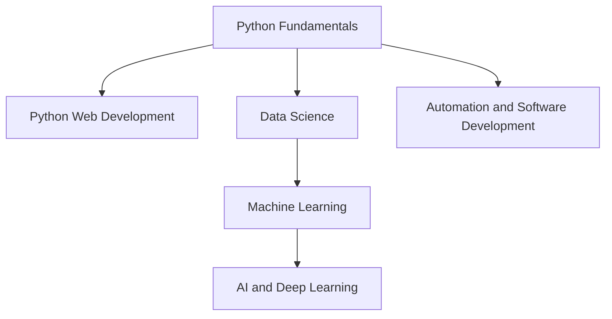

# LearnHub Python Learning Ecosystem: Phase 1 Design

Status: curriculum and architecture proposal only. This document does not authorize application changes, seed execution, or database writes.

## 1. Goals and boundaries

Create six original, progressive Python Learning Paths in the existing Learning Path system. Keep them separate from Instructor Courses and preserve the existing HTML5 path, its content, and its student progress. Python Fundamentals is required before every specialized path. Data Science is additionally required before Machine Learning, and Machine Learning before AI and Deep Learning.

Phase 1 establishes the curriculum, data contract, access policy, and tests. It does not create seed files, add code execution, or write data. Python code execution is excluded until a separate sandbox design and approval.

### Existing project contract

- `LearningPath` has a unique `seedKey`, unique slug, title, subtitle, description, language, audience, status, and content version. Do not repurpose `language`; it describes instructional language.
- `LearningModule` and `LearningLesson` are ordered beneath a path. Lessons already support objectives, explanations, terminology, syntax, worked code and output, mistakes, practices, summary, duration, and optional project content.
- `LearningExercise` currently stores HTML-specific requirements. `learningHtmlChecker` parses HTML and checks selectors; it does not run code. `HtmlEditor` and its preview are HTML-specific as well.
- `LearningQuiz` supports multiple-choice, true/false, code-output, and practical question types. The public serializer omits answer keys and explanations; those are returned after submission.
- Student progress and attempts are stored in Learning Path collections, separate from Instructor Course progress/enrollment.
- The HTML5 seed has its own `learnhub-html5-v1` namespace, validates its content before upserts, keeps stable document IDs on repeat runs, and does not seed progress or attempts. Tests use Node's built-in `node:test` and fake models to validate idempotence without MongoDB.
- Published Learning Paths use `/api/learning`; Instructor Courses use the Course model and their separate `/api/courses`, dashboard, and curriculum surfaces.

## 2. Prerequisite map



Prerequisite completion should mean the Fundamentals path's existing `LearningPathProgress.completedAt` is set. Specialized path cards and overviews remain visible so learners can plan; restricted lesson, assessment, exercise, project, and progress operations must be enforced by the API, not only hidden in the UI. For gated content, require an authenticated STUDENT and return an explicit prerequisite status. Do not change access to HTML5 or existing public paths.

## 3. Curriculum blueprint

Time estimates include lessons, practice, quizzes, and projects. Each lesson outcome below is observable and should be assessed through a short task or quiz item. Author new explanations and examples; use the references in section 4 for further reading, not as source text to reproduce.

### Track 1: Python Fundamentals

Prerequisites: none. Estimated time: 42 hours.

Track outcomes: install and use Python; solve problems with core types and control flow; structure reusable functions and modules; read/write common data files; test, debug, document, and package a small Python program.

| Module | Lessons and outcomes | Practice and quiz focus |
|---|---|---|
| 1. Setup and computational thinking (5 h) | **Install and inspect Python**: identify interpreter/version and run a script. **Use the REPL and editor**: evaluate expressions and save a runnable file. **Read Python syntax**: apply indentation, comments, and naming conventions. **Trace a small program**: predict state changes and locate a syntax/runtime error. | Configure a project and produce a first script with documented input/output. Quiz: interpreter vs script, syntax, trace reading, and error categories. |
| 2. Values and control flow (7 h) | **Use literals and variables**: choose string, integer, float, and boolean values. **Evaluate expressions**: apply precedence and explicit conversions. **Branch with conditions**: express decisions with `if`/`elif`/`else`. **Repeat work with loops**: select `for` or `while` and trace termination. | Build a command-line unit converter with boundary cases. Quiz: conversions, comparisons, branches, loop bounds, and termination. |
| 3. Strings and collections (7 h) | **Format and inspect strings**: use indexing, slicing, and formatted output. **Manage sequences**: select list or tuple and update/iterate safely. **Model keyed data**: add, retrieve, and update dictionary entries. **Use sets and comprehensions**: remove duplicates and express simple transformations. | Build a contact/inventory index using lists and dictionaries; test missing-key and empty-input cases. Quiz: mutability, membership, indexing, collection choice, and comprehension results. |
| 4. Functions, modules, and tests (7 h) | **Define functions**: use parameters, return values, and a single responsibility. **Choose arguments**: distinguish positional, keyword, and default arguments. **Organize modules**: import project code without import side effects. **Test function behavior**: write assertions for normal and edge cases. | Refactor a long script into tested functions and two small modules. Quiz: scope, return vs print, import behavior, and test assertions. |
| 5. Files, errors, and standard library (7 h) | **Manage paths and text files**: use `pathlib` and context managers. **Read structured data**: parse and validate CSV and JSON. **Handle failure deliberately**: raise/catch appropriate exceptions. **Use standard-library tools**: select `datetime`, `statistics`, or `argparse` for a task. | Produce a file-backed report tool that validates input and reports actionable errors. Quiz: file lifetimes, serialization, exception flow, and standard-library selection. |
| 6. Maintainable Python (9 h) | **Model related behavior**: define a small class and use composition. **Use dataclasses and type hints**: document structured values and function contracts. **Debug systematically**: reproduce, inspect, and isolate a defect. **Prepare a project**: apply PEP 8, run tests, and describe setup/use. | Capstone: a tested CLI application that imports/exports structured data, validates input, and includes a README. Quiz: object boundaries, typing, test purpose, debugging, and maintainability. |

Milestone project: a tested text/CSV/JSON command-line utility. Capstone expected outcome: a small installable or directly runnable application with modular source, tests, input validation, documentation, and example output. Completion remains lesson/quiz-based and the project checkoff is explicitly self-reported, not code-graded.

### Track 2: Python Web Development

Prerequisites: Python Fundamentals. Estimated time: 56 hours.

Track outcomes: explain request/response flow; build and test server-rendered Django features and typed FastAPI endpoints; validate inputs; use persistence and security fundamentals; prepare a maintainable web application for deployment.

| Module | Lessons and outcomes | Practice and quiz focus |
|---|---|---|
| 1. Web and HTTP foundations (9 h) | **Describe a web request**: identify client, server, method, path, headers, and body. **Use HTTP outcomes**: select status codes and explain safe/idempotent methods. **Represent API data**: encode/decode JSON and validate shape. **Configure a Python web project**: isolate dependencies and separate configuration from code. | Draw and implement a small request/response contract. Quiz: method semantics, status codes, JSON shape, and configuration risks. |
| 2. Django application fundamentals (12 h) | **Create a Django project and app**: identify settings, URLs, views, and app boundaries. **Route requests**: map URL patterns to views. **Render templates**: pass context and escape user-controlled output. **Model domain data**: define models and explain migrations. | Build a server-rendered catalog with list/detail views and a migration. Quiz: request lifecycle, route resolution, templates, models, and migrations. |
| 3. Forms, persistence, and security (12 h) | **Validate a form**: distinguish browser validation from server validation. **Persist a workflow**: implement create/read/update behavior with ORM constraints. **Protect sessions and forms**: explain CSRF and authentication boundaries. **Test Django behavior**: cover views, validation, and permissions with the test client. | Add a validated create/edit flow and authorization tests. Quiz: server-side validation, CSRF, permission checks, and test isolation. |
| 4. FastAPI typed services (11 h) | **Define typed routes**: use path/query parameters and response models. **Validate request bodies**: use Pydantic models and report errors consistently. **Compose dependencies**: share request-scoped concerns without global state. **Test an API contract**: assert success, validation, and error responses. | Build a small JSON API that mirrors a documented schema. Quiz: parameter sources, response models, validation, dependencies, and status codes. |
| 5. Production readiness (12 h) | **Choose Django or FastAPI**: justify a framework against requirements. **Connect persistence safely**: apply transactions and query boundaries. **Handle configuration/secrets**: read environment configuration without committing it. **Prepare a release**: test, document, and deploy with health/logging basics. | Capstone: one deployable application with documented routes, persistence, tests, and security checklist. Quiz: architecture tradeoffs, secrets, database boundaries, and deployment validation. |

Milestone projects: a Django CRUD workflow and a typed FastAPI service. Capstone expected outcome: a tested, documented web application with validated input, persistence, clear error behavior, and a deployment checklist. No Python code is executed by LearnHub.

### Track 3: Data Science

Prerequisites: Python Fundamentals. Estimated time: 55 hours.

Track outcomes: create reproducible analyses; manipulate arrays and tabular data; clean and validate datasets; select descriptive statistics and visualizations; communicate evidence and limitations.

| Module | Lessons and outcomes | Practice and quiz focus |
|---|---|---|
| 1. Reproducible analysis (9 h) | **Set up an analysis environment**: record dependencies and notebook purpose. **Inspect a dataset**: identify dimensions, types, and missingness. **Ask an answerable question**: define population, variables, and limits. **Make analysis reproducible**: use deterministic steps and source notes. | Create a notebook that loads a documented dataset and records assumptions. Quiz: reproducibility, variable types, sampling limitations, and notebook hygiene. |
| 2. NumPy foundations (10 h) | **Create arrays**: distinguish shape, dtype, and dimensionality. **Index and slice arrays**: select rows/columns without accidental copies. **Use vectorized operations**: replace suitable scalar loops with array operations. **Summarize numerical data**: calculate and interpret aggregate statistics. | Analyze a numerical table with shape assertions and vectorized transformations. Quiz: broadcasting, shape, indexing, dtype, and summary interpretation. |
| 3. pandas data wrangling (12 h) | **Inspect Series and DataFrames**: select columns and rows by label/position. **Clean missing and invalid values**: choose and justify a treatment. **Transform and group data**: use filtering, grouping, and aggregation. **Combine sources**: join tables and validate key cardinality. | Clean and join two tables; provide checks that catch duplicate or missing keys. Quiz: indexing, missingness, groupby, merge cardinality, and data leakage risks. |
| 4. Statistics and visualization (12 h) | **Describe distributions**: compare center, spread, and outliers. **Reason about samples**: distinguish population claims from sample evidence. **Visualize comparisons**: choose a chart that matches variable types. **Interpret uncertainty**: explain why descriptive correlation is not causation. | Create labeled plots and a short statistical interpretation with caveats. Quiz: chart selection, summary measures, sampling, confounding, and uncertainty. |
| 5. End-to-end analysis (12 h) | **Validate analysis inputs**: assert expected columns and ranges. **Build a clean workflow**: separate load, transform, analysis, and presentation steps. **Communicate findings**: connect claims to plots/tables and limitations. **Review ethics and privacy**: identify sensitive data and avoid unsupported claims. | Capstone: reproducible analysis notebook and concise findings report. Quiz: workflow order, data quality, privacy, and evidence-to-claim alignment. |

Milestone projects: a data-cleaning notebook and a visualization brief. Capstone expected outcome: a reproducible notebook, validated data transformations, well-labeled charts, a short evidence-based report, and explicit limitations. Use public datasets with licenses recorded in the lesson materials.

### Track 4: Machine Learning

Prerequisites: Python Fundamentals and Data Science. Estimated time: 64 hours.

Track outcomes: frame supervised learning problems; build preprocessing and model pipelines; compare regression/classification baselines; evaluate with suitable splits/metrics; identify leakage, bias, and overclaiming.

| Module | Lessons and outcomes | Practice and quiz focus |
|---|---|---|
| 1. ML workflow and evaluation (11 h) | **Frame a prediction task**: define target, unit, and decision context. **Build a baseline**: compare against a simple non-ML rule. **Split data correctly**: keep training, validation, and test roles distinct. **Avoid leakage**: identify target-derived and post-outcome features. | Write an evaluation plan before fitting a model. Quiz: baselines, splits, leakage, and generalization. |
| 2. Regression pipelines (13 h) | **Prepare feature columns**: distinguish numeric and categorical input. **Preprocess safely**: fit transforms only on training data. **Fit linear regression**: interpret coefficients with limitations. **Measure error**: choose and explain MAE/RMSE and residual checks. | Build a preprocessing/model pipeline and compare it with a baseline. Quiz: fitting boundaries, encoded features, error metrics, and residual interpretation. |
| 3. Classification and metrics (13 h) | **Fit a classifier**: distinguish labels from predicted probabilities. **Interpret a confusion matrix**: compute precision, recall, and specificity. **Select a threshold**: connect false positives/negatives to task costs. **Handle imbalance**: select stratification and suitable metrics. | Evaluate a classification model under two decision thresholds. Quiz: confusion matrix, threshold effects, class imbalance, and metric choice. |
| 4. Trees, ensembles, and validation (13 h) | **Train a decision tree**: explain depth and overfitting. **Compare ensembles**: distinguish bagging and boosting conceptually. **Use cross-validation**: estimate performance without reusing the final test set. **Tune parameters responsibly**: constrain search and preserve an untouched test set. | Compare baseline, tree, and ensemble with a reproducible validation table. Quiz: variance/overfit, validation folds, tuning bias, and test-set discipline. |
| 5. Interpretation and responsible use (14 h) | **Inspect model behavior**: use feature importance cautiously. **Check subgroup performance**: compare metrics across meaningful groups when appropriate. **Record an experiment**: preserve data version, parameters, and results. **Prepare a model report**: document intended use and limitations. | Capstone: prediction study with pipeline, baseline comparison, error analysis, and model card. Quiz: interpretability limits, fairness risks, reproducibility, and deployment boundaries. |

Milestone projects: a regression comparison and a classification evaluation report. Capstone expected outcome: a reproducible scikit-learn pipeline, leakage-safe evaluation, baseline comparison, error analysis, and a transparent limitations/impact report. Do not promise production decision quality from a tutorial dataset.

### Track 5: AI and Deep Learning

Prerequisites: Python Fundamentals, Data Science, and Machine Learning. Estimated time: 72 hours.

Track outcomes: reason about tensors and gradients; train and evaluate PyTorch models; compare neural architectures at an introductory level; reproduce experiments; report limitations, data provenance, and resource costs.

| Module | Lessons and outcomes | Practice and quiz focus |
|---|---|---|
| 1. Math and tensor foundations (12 h) | **Review vectors and matrices**: connect dimensions to features and batches. **Create tensors**: inspect shape, dtype, and device. **Express a loss function**: relate prediction error to an objective. **Trace gradients conceptually**: explain how parameters receive updates. | Implement small tensor operations and verify expected shapes/values. Quiz: dimensions, tensor operations, loss, and gradient direction. |
| 2. PyTorch training loop (14 h) | **Build a Dataset and DataLoader**: batch records consistently. **Define an `nn.Module`**: connect layers and forward pass. **Train with autograd**: clear gradients and update parameters safely. **Evaluate without training state**: separate optimization and evaluation. | Train a tiny model and log loss/validation metrics across epochs. Quiz: forward/backward pass, optimizer steps, data splits, and evaluation mode. |
| 3. Neural networks and vision (14 h) | **Compose dense layers**: track shape and activation. **Explain overfitting**: compare training/validation curves. **Build a small CNN**: describe convolution and pooling roles. **Inspect model errors**: examine examples rather than only aggregate score. | Compare a dense baseline and compact CNN on a permitted small dataset. Quiz: activation, shape flow, overfit, and error-analysis rationale. |
| 4. Sequences and attention (15 h) | **Represent ordered data**: identify token, sequence, and padding concepts. **Describe recurrent approaches**: identify limitations in long-range sequence learning. **Explain attention**: interpret query/key/value at a conceptual level. **Read a transformer block**: map attention and feed-forward stages without treating it as magic. | Trace a tiny attention example and document a sequence-model tradeoff. Quiz: sequence shapes, attention roles, masking purpose, and model limits. |
| 5. Reproducibility and responsible AI (17 h) | **Reproduce an experiment**: set seeds and record environment/data versions. **Evaluate beyond one score**: report class-wise behavior and uncertainty limits. **Estimate resource needs**: track runtime, memory, and model size. **Review provenance and impacts**: document data rights, bias, and intended use. | Capstone: PyTorch experiment with baseline, training log, evaluation, and model card. Quiz: reproducibility, data provenance, metric limits, and responsible communication. |

Milestone projects: a small image classifier and an attention walkthrough. Capstone expected outcome: source/notebook, reproducible training configuration, baseline, evaluation/error analysis, resource notes, dataset attribution, and a model card. This path teaches using PyTorch; LearnHub will not execute submitted models.

### Track 6: Automation and Software Development

Prerequisites: Python Fundamentals. Estimated time: 48 hours.

Track outcomes: build safe command-line tools; automate file and API workflows; structure and test software; log and recover from expected failures; package and maintain a small Python application.

| Module | Lessons and outcomes | Practice and quiz focus |
|---|---|---|
| 1. Command-line tools (9 h) | **Design a CLI contract**: define commands, arguments, and exit codes. **Parse arguments**: use `argparse` with helpful usage. **Work with paths safely**: use `pathlib` and explicit input/output directories. **Make operations previewable**: distinguish dry-run from apply behavior. | Build a read-only file inventory CLI with a dry-run report. Quiz: CLI design, paths, exit codes, and destructive-operation safeguards. |
| 2. Data and API automation (10 h) | **Parse structured files**: validate CSV and JSON records. **Call a web API**: set timeouts and handle status codes. **Respect operational boundaries**: use rate limits and authorization scopes. **Make repeatable transformations**: ensure input/output behavior is deterministic. | Generate a report from a local fixture and mocked API response. Quiz: timeouts, retries, idempotency, rate limits, and input validation. |
| 3. Reliability and observability (9 h) | **Handle expected errors**: fail with actionable context. **Use logging**: choose levels and avoid secrets in logs. **Manage configuration**: validate environment settings and defaults. **Review filesystem/process safety**: constrain paths and avoid unsafe shell interpolation. | Add logging and recovery to a batch import tool using temporary fixtures. Quiz: exception boundaries, logging hygiene, safe paths, and shell risks. |
| 4. Tests and maintainability (10 h) | **Test pure behavior**: cover success, boundary, and failure cases. **Mock external systems**: isolate filesystem/API boundaries. **Apply type hints and refactoring**: clarify interfaces without overengineering. **Review changes**: use coverage as evidence, not a goal by itself. | Add unit and integration-boundary tests to the reporting tool. Quiz: test isolation, mocking tradeoffs, typing, and regression coverage. |
| 5. Packaging and delivery (10 h) | **Describe a package**: separate importable modules and entry points. **Configure build metadata**: state dependencies and supported Python versions. **Automate quality checks**: run tests/lint in CI. **Plan safe releases**: document compatibility, changelog, and rollback. | Capstone: package and CI-check a safe batch-processing CLI. Quiz: package metadata, versioning, CI evidence, and release safety. |

Milestone projects: a local report generator and a tested API-to-file synchronizer using fixtures. Capstone expected outcome: a packaged CLI with documented command behavior, dry-run support, timeouts, structured logs, tests, and CI configuration. Use temporary test data; examples must not delete user files or contact live services by default.

## 4. Resources and teaching practice

Use the resources as references and alignment points. Lesson prose, examples, questions, and projects must be authored for LearnHub and must not reproduce course text, exercises, or answer keys.

| Area | Recommended resources |
|---|---|
| Core language and style | [Official Python Tutorial](https://docs.python.org/3/tutorial/), [Library Reference](https://docs.python.org/3/library/), [PEP 8](https://peps.python.org/pep-0008/), [Python Packaging User Guide](https://packaging.python.org/en/latest/) |
| Beginner practice | [Harvard CS50P](https://cs50.harvard.edu/python/), [freeCodeCamp Scientific Computing with Python](https://www.freecodecamp.org/learn/scientific-computing-with-python/) |
| Web | [Django documentation](https://docs.djangoproject.com/en/stable/), [FastAPI tutorial](https://fastapi.tiangolo.com/tutorial/) |
| Data and ML | [Kaggle Learn](https://www.kaggle.com/learn), [Google Machine Learning Crash Course](https://developers.google.com/machine-learning/crash-course), [scikit-learn User Guide](https://scikit-learn.org/stable/user_guide.html) |
| Deep learning | [Official PyTorch Tutorials](https://pytorch.org/tutorials/) |

Teaching requirements: state measurable outcomes; introduce one major concept at a time; model an example before asking learners to transfer it; use short retrieval quizzes with explanation; revisit core skills in spaced practice; include edge cases and debugging; make datasets, licenses, and assumptions explicit; use inclusive, accessible examples; and provide a glossary and references per module. Each quiz answer must have one validated key and an original explanation that explains the governing concept, not merely restates the answer. Where practical, add a sentence about the most likely misconception to the explanation.

## 5. Learning Path data architecture

### Track and module records

Represent each track as its own published `LearningPath` record; do not create an Instructor `Course`. Proposed backward-compatible optional path metadata:

```js
{
  subject: "python",
  trackKey: "fundamentals",
  trackOrder: 1,
  prerequisiteSlugs: [],
  estimatedHours: 42,
  completionMode: "lesson-and-quiz"
}
```

Specialized records use their own stable slugs, such as `python-web-development`, `python-data-science`, `python-machine-learning`, `python-ai-deep-learning`, and `python-automation-software-development`. Store prerequisite slugs rather than ObjectIds so the curriculum manifest remains stable across environments; validate every prerequisite exists and that the graph is acyclic. Keep all existing required path fields and existing HTML5 values unchanged.

Modules remain ordered with path-local slugs and objectives. Lessons remain ordered within modules and use the existing rich `content` fields. Add a content manifest validator for unique track/module/lesson slugs, expected counts, valid references, objective coverage, durations, code examples, and quiz minimums.

### Exercises and projects without a runner

The current exercise model requires HTML selector requirements, and the submit API accepts HTML. Do not store Python tasks in those fields or send Python to `learningHtmlChecker`.

Proposed future schema/API distinction:

- Add an exercise language/type discriminator and a separate public self-check list for Python practice. Preserve the current HTML requirement schema and behavior for HTML5.
- Python tasks may include instructions, starter code, hints, self-check criteria, and a hidden reference solution. The frontend may show an editor for drafting, but must not execute it or label the answer as passed. Without a runner there is no Python `exerciseAttempts` pass result.
- Use existing `LearningLesson.project` for Python project briefs, learning outcomes, steps, expected output, checklist, and protected reference solution. Do not duplicate the project in both lesson and exercise records.
- Track completion of project lessons through existing `LearningLessonProgress` and visibly label any checklist as learner self-review. It is not instructor-graded or machine-verified.
- Existing `recomputePathCompletion` requires at least one passed project exercise. Add a path-specific completion policy so legacy HTML5 behavior remains `exercise-pass` while Python can use `lesson-and-quiz` plus completed project lessons. Test both policies. Do not silently relax the HTML5 completion condition.

An isolated Python execution service, automated tests against submissions, and sandbox grading are explicitly out of scope. They require a separate threat model, deployment, quotas, filesystem/network restrictions, timeouts, and approval.

### Stable IDs, idempotency, and preservation

- Use a separate seed namespace, for example `learnhub-python-v1`, with keys including track, record kind, and stable slug. Never reuse `learnhub-html5-v1` keys.
- Use the existing `findOneAndUpdate({ seedKey }, { $set: ... }, { upsert: true })` approach only for Python-owned records. Retain `_id` on rerun; validate all source data before the first write.
- Seed only Learning Path content collections. Do not create or reset `LearningPathProgress`, `LearningLessonProgress`, bookmarks, exercise attempts, or quiz attempts.
- Provide a dry-run mode that reports expected insert/update counts and slug/seed-key conflicts before writes. Do not execute it or any seed in Phase 1.
- During an eventual approved seed, compare before/after HTML5 document IDs and content versions, and assert there are no writes to Course, Enrollment, Instructor Course progress, or any progress/attempt collection.

## 6. API and frontend architecture

### API

Reuse `/api/learning`; keep Instructor Course routes unchanged. Extend the public Learning Path list/overview response with subject, track, estimated hours, prerequisite slugs, and an access summary when a student token is supplied. Continue to omit `seedKey`, quiz answer keys, explanations before submission, and stored solution code.

Add one centralized prerequisite check that:

1. Loads the required published paths and checks the authenticated student's `LearningPathProgress.completedAt` for each prerequisite.
2. Allows public catalog and high-level track/module outlines.
3. Gates lesson content, quizzes/assessments, exercises, project details, visit/completion writes, and submissions for a specialized path when prerequisites are unmet.
4. Returns an explicit response listing required and incomplete prerequisite slugs; does not reveal quiz keys or solutions.
5. Leaves current HTML5 endpoints and behavior unchanged when the path has no prerequisites.

Because current lesson and assessment reads are public, the gated Python read routes need optional authentication: preserve public behavior for ungated paths; for gated Python content return a sign-in response if no student is authenticated and a prerequisite response if incomplete. Enforce the rule server-side for deep links, not just through disabled buttons.

Quizzes remain server-scored. Each quiz has 3+ validated questions, unique `questionKey`s, valid choice IDs and an explanation for every answer. Public quiz serializers return prompts/choices only; correctness/explanations are returned after the student's submission. Practical questions remain review-only and do not inflate an automatic score.

### Frontend

Extend the existing Learning Paths list and overview to group or label the six Python tracks, display estimated hours and prerequisite state, and link to each track. Keep HTML5 visible and retain its current route/content. Show specialized content as locked with prerequisite links and clear completion state, while allowing browsing of high-level summaries.

Reuse lesson, module, quiz, project, and progress screens. Add a Python-specific non-executing practice view rather than adapting `HtmlEditor`; render the brief, starter code, hints, and self-check criteria without a Run or automated Submit action. Mark project checklists as self-review. Preserve keyboard access, responsive layout, and existing student progress controls.

## 7. Testing strategy

Use the repository's existing `node:test`, `assert/strict`, and fake-model conventions. Curriculum and seed tests must not connect to MongoDB.

### Curriculum and seed tests

- Validate exactly six unique Python track slugs, required metadata, duration bounds, and the expected prerequisite graph.
- Validate every module/lesson order is unique and contiguous; every lesson has measurable objectives, substantive explanation, terms, syntax, code/example output, summary, mistakes, best practices, and duration.
- Validate every exercise has language/type-specific fields and at least two hints; Python checks must not require HTML selectors.
- Validate every project has objectives, steps, expected outcome, checklist, and protected solution material.
- Validate every quiz has at least three questions, unique keys, choices, one valid key per objective question, and non-empty answer explanations; practical questions need requirements/rubric and remain review-only.
- Validate seed keys are namespaced and unique across every Python record; malformed prerequisites or content fail before any fake model write.
- Seed twice using fake models: collection sizes and IDs remain stable, counts are deterministic, and no progress/attempt fake model is written.
- Assert HTML5 seed data, stable-key namespace, path slug, and required content are unchanged. Add regression tests that HTML5's existing project-pass completion policy remains intact when Python uses lesson-and-quiz completion.

### API, privacy, gating, and progress tests

- Test Python track metadata in list and overview responses and verify HTML5 remains listed and ungated.
- Test missing token, non-student role, incomplete prerequisite, and completed prerequisite behavior on content reads and writes.
- Test every gated route, including direct lesson/quiz/exercise/project access, visit/completion, and submissions; UI-only gating is insufficient.
- Test public quiz responses omit answer keys, explanations, rubric/requirements that should remain hidden, seed keys, and reference solutions; after-submission feedback is scoped to the submitted student.
- Test practical items are excluded from automatic score calculation.
- Test progress and attempts for one learner are not returned to another learner and are keyed to the correct path/lesson/quiz IDs.
- Test Python self-check exercises cannot use the HTML submission API and that HTML checker behavior is unchanged.

### Future runner security tests (not part of Phase 1 or the initial no-runner implementation)

If a runner is separately approved, require isolation tests for no network access, CPU/wall-clock/memory limits, process and output caps, filesystem confinement, import restrictions, cancellation, malicious/infinite loops, dependency policy, and cleanup after failures. Never execute submitted code in the Express process.

## 8. Implementation roadmap

| Phase | Scope | Gate |
|---|---|---|
| 1. Curriculum and architecture | This proposal only; confirm prerequisites, learner hours, self-check project policy, and content authoring level. | Current phase; no application/database changes. |
| 2. Data contract and content validator | Add optional track/prerequisite metadata, exercise type/self-check representation, path completion mode, and pure validation tests. Preserve old schema defaults and HTML5 behavior. | User approval for Phase 2. |
| 3. Curriculum authoring and isolated seed | Create six Python data manifests and a namespaced idempotent seed with dry-run reporting and fake-model tests. | Content review; no database run until separate explicit write approval. |
| 4. API gates and frontend experience | Add prerequisite enforcement, metadata/UI, Python non-executing practice and project self-review, plus API privacy/progress tests. | User approval; no runner. |
| 5. Controlled data rollout | Review dry-run insert/update/conflict report and HTML5 preservation checks; apply only explicitly approved Python-owned writes. | Exact records, target DB, and write method approved immediately before execution. |
| Future, separately scoped | Threat model and isolated Python execution/grading service. | Explicit separate approval; not included in this roadmap's implementation phases. |

## 9. Decisions still needed

1. Confirm that course completion may be self-reported for Python projects until a separately approved evaluator exists.
2. Confirm estimated hours and whether learners should be allowed to take Web/Automation directly after Fundamentals while Data Science → Machine Learning → AI remains sequential.
3. Confirm whether specialized path lessons should require a logged-in STUDENT (recommended for enforceable prerequisites) while catalog summaries remain public.
4. Choose minimum supported Python version for the authored examples; proposed curriculum should name one version and test syntax against it.
5. Confirm whether the initial Python curriculum should publish all six tracks together or publish Fundamentals first and gate downstream paths as drafts until content review.

## 10. Phase 1 verification

This document is the only proposed Phase 1 artifact. No application source, existing HTML5 data, tests, uncommitted `LearningPaths.jsx`/`LearningPaths.css` changes, database records, or seed files were changed or executed. Application tests, database integration, seed behavior, and browser behavior were not run for this documentation-only assessment.